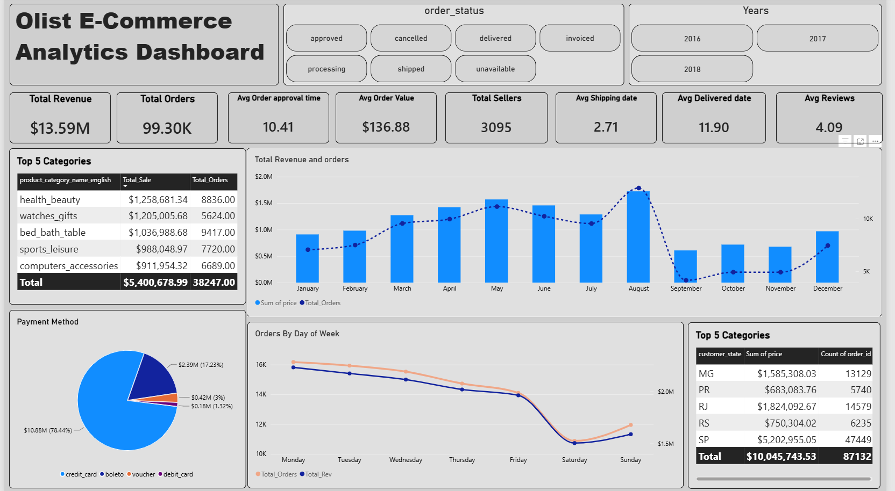
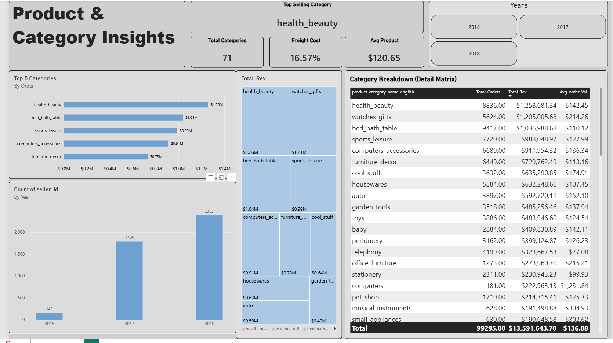

# olist-ecommerce-analytics
# 🛒 End-to-End Olist E-Commerce Data Analytics Project

An end-to-end data analytics pipeline project built to analyze the Brazilian Olist E-Commerce dataset, focusing on sales performance, logistics, order fulfillment, and seller performance metrics.

---

## 🔄 Project Pipeline & Workflow

The analysis follows a robust multi-stage pipeline combining SQL, Python, and Power BI:

1. **Database Setup & Data Import (`E_commerce.sql`)**:
   - Imported multi-table relational datasets into **PostgreSQL**.
   - Executed structural verification, data type casting, and timestamp standardizations.
   - Applied CTEs and `ROW_NUMBER()` window functions to handle missing values and remove duplicate records.

2. **Exploratory Data Analysis & Validation (`E_commerce.ipynb`)**:
   - Processed cleaned data using **Python (Pandas & NumPy)** to analyze sales trends and delivery lead times.
   - Validated transaction distributions and cross-checked metrics against PostgreSQL queries.

3. **Data Visualization & Dashboarding (`E_commerce.pbix`)**:
   - Connected cleaned tables to **Power BI** using a Star Schema data model.
   - Formulated custom DAX measures for key metrics including Revenue, Average Order Value (AOV), Delivery Delays, and Seller Performance.
   - Designed a 2-page interactive dashboard for executive insights.

---

## 🛠️ Tech Stack & Tools

- **Database & Querying:** PostgreSQL (Multi-table Joins, CTEs, Window Functions, Data Cleaning)
- **Data Processing & EDA:** Python (Pandas, NumPy)
- **Visualization & Business Intelligence:** Power BI (DAX Measures, Star Schema Modeling, Interactive Dashboards)

---

## 📊 Dashboard Previews

### Page 1: Sales & Revenue Overview


### Page 2: Product & Seller Insights


---

## 📂 Repository Structure

```text
├── E_commerce.sql     # PostgreSQL scripts for data import, cleaning, and schema setup
├── E_commerce.ipynb   # Python notebook for exploratory data analysis
├── E_commerce.pbix    # Power BI interactive report and data model
├── Dashboard_1.png    # Sales & Revenue Overview Screenshot
├── Dashboard_2.png    # Product & Seller Insights Screenshot
└── README.md          # Project Documentation
